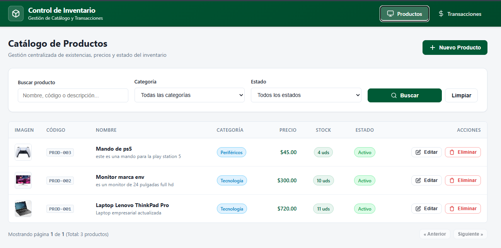
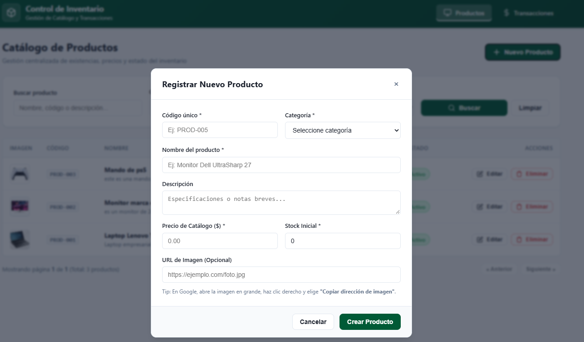
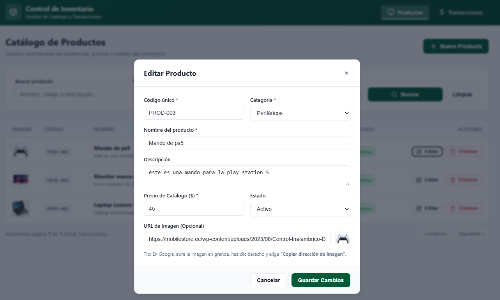
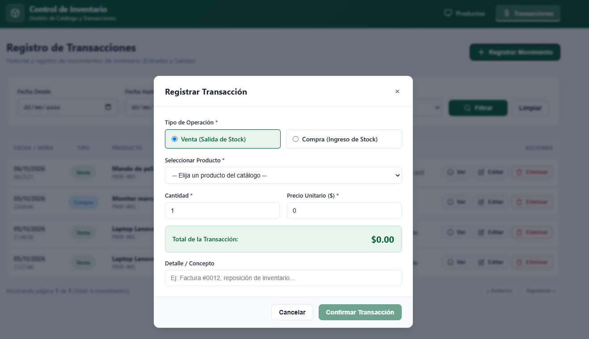
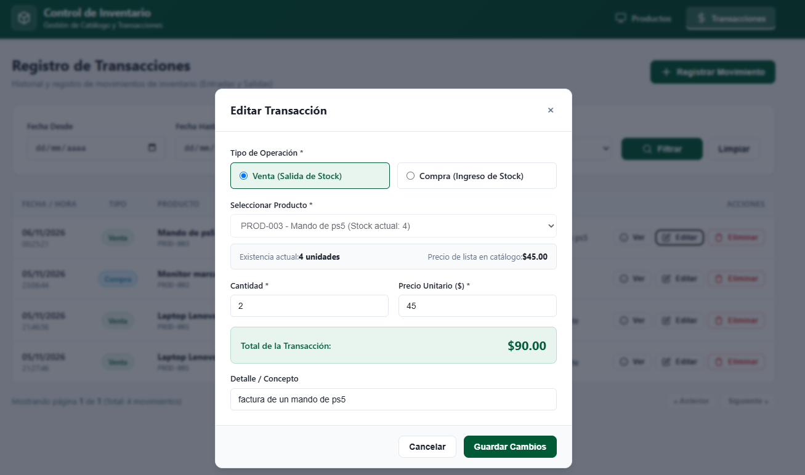
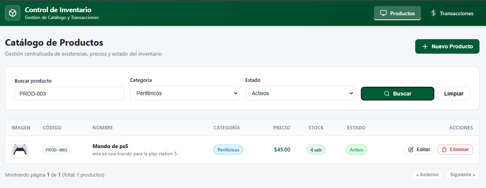
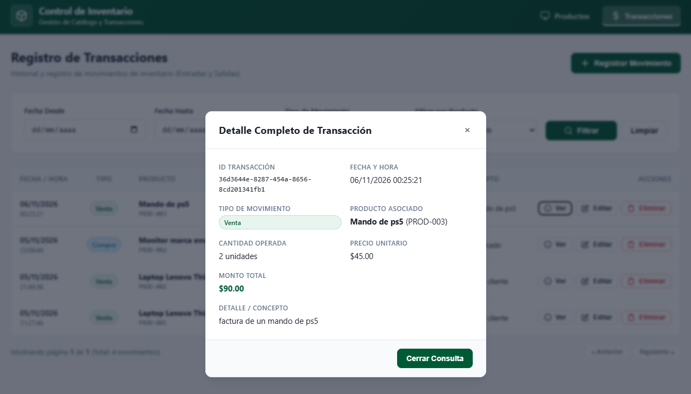

# Sistema de Gestión de Inventario y Transacciones
### Evaluación Técnica Fullstack (.NET Microservicios + Angular)

Solución integral basada en arquitectura de microservicios con backend desacoplado en **.NET Core** (Arquitectura Hexagonal / Puertos y Adaptadores), frontend interactivo en **Angular** y base de datos relacional **PostgreSQL**.

---

## 1. Requisitos del Sistema

Antes de ejecutar el proyecto en tu entorno local, asegúrate de tener instalado:

* **.NET SDK:** Versión 10.0 (o .NET 8.0+)
* **Node.js:** Versión 20.x o 24.x LTS (incluye `npm`)
* **Angular CLI:** Versión 21.x (`npm install -g @angular/cli`)
* **PostgreSQL:** Versión 14 o superior (instalado localmente o mediante pgAdmin)

---

## 2. Configuración de Base de Datos (SQL)

El proyecto incluye el script de inicialización completo en la raíz: [`init.sql`](init.sql).

1. Abre tu gestor de base de datos PostgreSQL.
2. Crea una base de datos llamada `inventory_db` (o utiliza una existente).
3. Ejecuta el script (init.sql) ubicado en la raíz del repositorio.
   * Crea automáticamente los esquemas `catalog` e `inventory`.
   * Crea las tablas `catalog.products` e `inventory.transactions`.
   * Configura las restricciones de integridad (`ON DELETE RESTRICT`) e índices de búsqueda rápida.
   * Inserta los datos semilla iniciales para pruebas.

> **Parámetros de conexión por defecto:**  
> Host: `localhost` | Puerto: `5432` | Base de datos: `inventory_db` | Usuario: `postgres` | Contraseña: `TuPassword`  
> *(Si tu contraseña de postgres local es diferente, puedes ajustarla en el archivo `appsettings.json` de cada microservicio en la sección `DatabaseSettings`).*

---

## 3. Ejecución del Backend (.NET Microservicios)

El backend está compuesto por 2 microservicios independientes que se comunican síncronamente vía REST:

### Terminal 1: Microservicio de Productos (Puerto 5001)
Desde la raíz del proyecto, ejecuta:
```powershell
dotnet run --project backend/ProductsService/ProductsService.API
```
* **URL Base:** `http://localhost:5001/api/products`
* **Swagger UI Interactivo:** `http://localhost:5001/swagger`

### Terminal 2: Microservicio de Transacciones (Puerto 5002)
En una segunda terminal, ejecuta:
```powershell
dotnet run --project backend/TransactionsService/TransactionsService.API
```
* **URL Base:** `http://localhost:5002/api/transactions`
* **Swagger UI Interactivo:** `http://localhost:5002/swagger`

---

## 4. Ejecución del Frontend (Angular)

El frontend es una aplicación Single Page Application (SPA) construida con componentes Standalone y estilos institucionales.

### Terminal 3: Aplicación Angular (Puerto 4200)
En una tercera terminal, ejecuta:
```powershell
cd frontend
npm install
npm start
```
Una vez compilado, abre en tu navegador web:
👉 **`http://localhost:4200`**

---

## 5. Arquitectura y Características Implementadas

* **Arquitectura Hexagonal (Clean Architecture):** Cada microservicio está separado en capas independientes:
  * `Domain`: Entidades del núcleo y puertos de repositorio.
  * `Application`: Casos de uso, validaciones DTO y puertos de clientes síncronos.
  * `Infrastructure`: Implementación con Entity Framework Core (Npgsql) y cliente HTTP REST.
  * `API`: Controladores RESTful con CORS configurado para Angular.
* **Comunicación Síncrona REST:** El microservicio de transacciones consulta productos y ajusta el stock de forma síncrona mediante `HttpClient` desacoplado a través de `IProductServiceClient`.
* **Regla Compleja de Validación de Stock:** El sistema valida en tiempo real tanto en frontend como en backend que no sea posible vender más unidades del stock disponible.
* **Tablas Dinámicas y Filtros:** Búsquedas por texto, categorías, estados, rangos de fechas y tipos de operación con paginación integrada.
* **Separación Estricta:** Componentes desacoplados en archivos `.ts`, `.html` y `.css` independientes.

---

## 6. Evidencias del Sistema

*(Coloca tus capturas de pantalla dentro de la carpeta `docs/screenshots/` con los nombres indicados para que se muestren automáticamente).*

### 1. Listado dinámico de productos y transacciones con paginación
*Listado con paginación, insignias de estado y botones de acción.*



---

### 2. Pantalla para la creación de productos
*Modal reactivo con validaciones obligatorias, categoría, stock y precio.*



---

### 3. Pantalla para la edición de productos
*Modal de edición con datos precargados, código protegido y vista previa de imagen.*



---

### 4. Pantalla para la creación de transacciones
*Modal de registro con validación compleja en tiempo real (alerta de stock insuficiente en venta y cálculo dinámico de total).*



---

### 5. Pantalla para la edición de transacciones
*Modal de modificación de movimiento con reajuste automático de stock en el producto asociado.*



---

### 6. Pantalla de filtros dinámicos
*Filtros avanzados por rango de fechas (Desde - Hasta), tipo de movimiento o categoría en tiempo real.*



---

### 7. Pantalla para la consulta de información de un formulario (Extra)
*Ficha técnica detallada de solo lectura con identificador único UUID, producto, montos y auditoría.*


